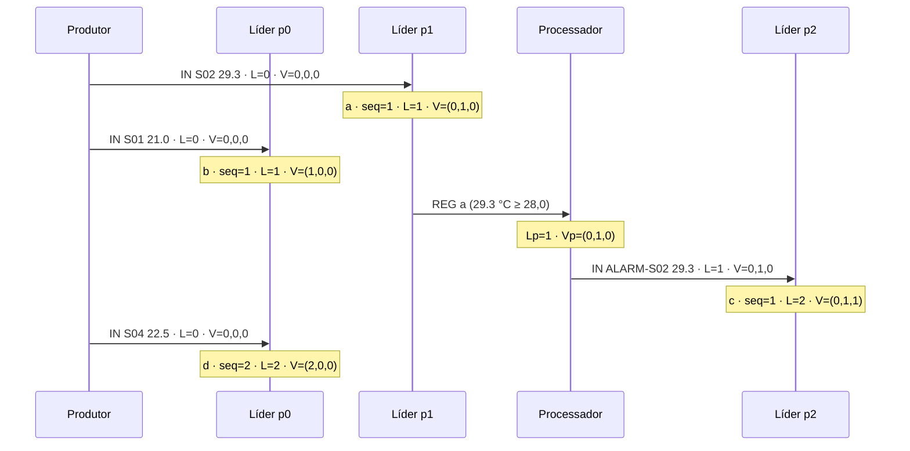

*Sistemas Distribuídos · Ficha prática*

# COMINDIR03 · Relógios Lógicos e Relógios Vetoriais sobre Partições

A presente ficha dá continuidade à COMINDIR02. Nessa ficha, cada partição dispõe de uma sequência própria e os números de sequência de partições distintas não admitem qualquer comparação. Introduz-se agora um processo que reage a registos de uma partição e origina eventos noutra, criando **dependências causais entre partições**. Para as representar, cada líder passa a manter um **relógio lógico de Lamport** e um **relógio vetorial**, que acompanham cada registo. O objetivo é determinar que relações de ordem entre registos de partições diferentes podem ser estabelecidas com cada um dos mecanismos.

`Tempo lógico` · `Relação «aconteceu antes»` · `Relógio de Lamport` · `Relógio vetorial` · `Concorrência` · `Causalidade entre partições` · `Publish/Subscribe` · `IPFS`

## Enquadramento

### Ponto de partida

Na COMINDIR02, a ordem garantida é **por partição**: o líder da partição *k* numera os registos e as réplicas aplicam-nos por essa ordem. Os líderes não comunicam entre si, pelo que os registos de partições diferentes são, nessa arquitetura, sempre **concorrentes**. A questão de diagnóstico (c) da COMINDIR02 conclui que os números de sequência de duas partições nada revelam sobre a ordem das respetivas leituras.

Esta situação altera-se quando um processo **observa** uma partição e **escreve** noutra. Nessa circunstância, o registo escrito depende causalmente do registo observado, e essa dependência deixa de ser visível através dos números de sequência.

|                                   | COMINDIR02                     | COMINDIR03                                                       |
| --------------------------------- | ------------------------------ | ---------------------------------------------------------------- |
| Escritores                        | produtor                       | produtor e processador de alarmes                                |
| Dependências entre partições      | inexistentes                   | criadas pelo processador                                         |
| Informação temporal em cada `REG` | `seq` da partição              | `seq`, relógio de Lamport *L* e relógio vetorial *V*            |
| Ordem entre partições             | nenhuma                        | ordem causal determinável com *V*; ordem total arbitrada com *L* |

### A relação «aconteceu antes»

Lamport (1978) define a relação **«aconteceu antes»**, denotada *a* → *b*, como a menor relação que satisfaz três condições: (i) se *a* e *b* ocorrem no mesmo processo e *a* precede *b*, então *a* → *b*; (ii) se *a* é o envio de uma mensagem e *b* a sua receção, então *a* → *b*; (iii) se *a* → *b* e *b* → *c*, então *a* → *c*. Dois eventos para os quais nem *a* → *b* nem *b* → *a* se dizem **concorrentes**, *a* ∥ *b*.

Nesta ficha, os **eventos** considerados são as atribuições de número de sequência efetuadas pelos líderes. Os líderes são, portanto, os processos cujo tempo lógico se regista. O produtor e o processador não geram eventos: limitam-se a transportar, nas mensagens `IN`, o conhecimento causal que detêm.

### Relógio de Lamport

Cada líder mantém um contador inteiro *L*. Ao atribuir um número de sequência a uma mensagem `IN` que transporta o carimbo *L*<sub>msg</sub>, o líder executa:

```
L = max(L, L_msg) + 1
```

O relógio de Lamport satisfaz a **condição de relógio**: se *a* → *b*, então *L*(*a*) < *L*(*b*). A implicação inversa **não** se verifica: de *L*(*a*) < *L*(*b*) não se pode concluir que *a* → *b*. Ordenando os eventos pelo par (*L*, *k*), em que *k* é o número da partição, obtém-se uma **ordem total** consistente com a causalidade, que ordena de forma arbitrária os eventos concorrentes.

### Relógio vetorial

Cada líder mantém um vetor *V* de dimensão **N**, o número de partições, com uma componente por líder. Ao atribuir um número de sequência a uma mensagem `IN` que transporta o vetor *V*<sub>msg</sub>, o líder da partição *k* executa:

```
para cada i: V[i] = max(V[i], V_msg[i])
V[k] = V[k] + 1
```

A comparação de vetores define-se por: *V*(*a*) ≤ *V*(*b*) se *V*(*a*)[*i*] ≤ *V*(*b*)[*i*] para todo o *i*; e *V*(*a*) < *V*(*b*) se *V*(*a*) ≤ *V*(*b*) e *V*(*a*) ≠ *V*(*b*). O relógio vetorial **caracteriza** a relação de causalidade:

- *a* → *b* se e só se *V*(*a*) < *V*(*b*);
- *a* ∥ *b* se e só se nem *V*(*a*) ≤ *V*(*b*) nem *V*(*b*) ≤ *V*(*a*).

Como apenas o líder da partição *k* incrementa a componente *k*, após cada evento verifica-se *V*[*k*] = `seq`. O relógio vetorial generaliza, assim, o número de sequência da COMINDIR02.

### O processador de alarmes

Introduz-se um novo processo, o **processador de alarmes**, que subscreve os tópicos de dados de todas as partições. O processador mantém um vetor *V*<sub>p</sub> e um contador *L*<sub>p</sub>, que atualiza com o máximo, componente a componente, de todos os registos recebidos. Quando recebe um registo com temperatura igual ou superior a `LIMIAR_ALARME` = 28,0 °C, publica uma leitura derivada com o sensor `ALARM-<sensor>`, transportando *L*<sub>p</sub> e *V*<sub>p</sub>. A partição da leitura derivada é determinada pela função de partição da COMINDIR02, aplicada ao identificador `ALARM-<sensor>`, e pode por isso diferir da partição do registo que a originou.

O processador **ignora** registos cujo sensor começa por `ALARM-`, de modo a evitar alarmes sobre alarmes. O produtor envia sempre *L* = 0 e *V* = (0, …, 0), uma vez que não observa registo algum.

### Formato das mensagens e dos ficheiros

O vetor é representado pelas suas componentes separadas por vírgulas, por exemplo `0,1,1` para N = 3.

| Canal                    | Mensagem                                                                     |
| ------------------------ | ---------------------------------------------------------------------------- |
| tópico `rep03-in-p<k>`   | `IN;<sensor>;<temperatura>;<L>;<V>`                                          |
| tópico `rep03-p<k>`      | `REG;<endereço>;<porto>;<seq>;<sensor>;<temperatura>;<instante>;<L>;<V>`     |
| ligação TCP de recuperação | `PEDIDO`, linhas de registo e `FIM`, como na COMINDIR02                    |

As linhas dos ficheiros passam a ter o formato `seq;sensor;temperatura;instante;L;V`. A recuperação por TCP mantém-se inalterada, transferindo os carimbos juntamente com os registos.

### Exemplo

A figura seguinte representa quatro eventos num sistema com N = 3. Com a função de partição da COMINDIR02, `S01` e `S04` pertencem a p0, `S02` a p1 e `ALARM-S02` a p2.



**Figura 1.** Diagrama espaço-tempo com os carimbos atribuídos pelos líderes. O evento *c* resulta da observação de *a* pelo processador.

Da figura decorrem as relações seguintes:

| Par      | *V*                     | *L*      | Relação causal | Ordem por (*L*, *k*) |
| -------- | ----------------------- | -------- | -------------- | -------------------- |
| *a*, *c* | (0,1,0) < (0,1,1)       | 1 < 2    | *a* → *c*      | *a* antes de *c*     |
| *b*, *d* | (1,0,0) < (2,0,0)       | 1 < 2    | *b* → *d*      | *b* antes de *d*     |
| *b*, *c* | incomparáveis           | 1 < 2    | *b* ∥ *c*      | *b* antes de *c*     |
| *c*, *d* | incomparáveis           | 2 = 2    | *c* ∥ *d*      | *d* antes de *c*     |

O par (*b*, *c*) ilustra a limitação do relógio de Lamport: *L*(*b*) < *L*(*c*), mas os eventos são concorrentes. O par (*c*, *d*) mostra que, em caso de empate, a ordem total é decidida pelo número da partição, um critério sem significado causal.

## 1 · Objetivos

No final desta tarefa, o aluno deve ser capaz de:

1. **Definir** a relação «aconteceu antes» e **identificar**, num diagrama espaço-tempo, pares de eventos causalmente relacionados e pares concorrentes.
2. **Implementar** o relógio de Lamport e o relógio vetorial nos líderes de partição, propagando os carimbos através das mensagens `IN` e `REG`.
3. **Explicar** por que razão a condição de relógio de Lamport não permite detetar concorrência e por que razão o relógio vetorial a caracteriza.
4. **Justificar** a dimensão do vetor e a equivalência entre *V*[*k*] e o número de sequência da partição *k*.
5. **Medir**, sobre os ficheiros produzidos, a proporção de pares concorrentes que o relógio de Lamport ordena e o custo, em bytes, de transportar o vetor.
6. **Reconhecer** as limitações que se mantêm: dimensão fixa do vetor, perdas no troço produtor → líder e ausência de entrega causal nas réplicas.

## 2 · Âmbito e pré-requisitos

### 2.1 · Âmbito

Esta ficha trata **exclusivamente** de: relógios de **Lamport** e relógios **vetoriais** mantidos pelos líderes de partição; propagação dos carimbos nas mensagens do **PubSub do IPFS** e nas respostas de recuperação por **TCP**; um processador que cria dependências causais entre partições; e a análise *a posteriori* das relações de ordem a partir dos ficheiros. Pressupõe **Java 11 ou superior** e a ficha **COMINDIR02** concluída, cujo código serve de base.

> **Limite explícito:** não se recorre a **entrega causal** nas réplicas (retenção de registos até que as dependências de outras partições estejam aplicadas), a **sincronização de relógios físicos** (Cristian, Berkeley, NTP), a **eleição de líder** ou **consenso**, a **reparticionamento** dinâmico, a **relógios vetoriais de dimensão variável** ou a **matrizes de relógios**, nem a **bibliotecas externas** ou *frameworks*. As réplicas aplicam os registos segundo a regra da COMINDIR02, sem consultar os carimbos. Se uma questão exigir um dos mecanismos excluídos para ter resposta completa, a conclusão a retirar é que **a solução desta ficha não resolve esse problema**. Este limite aplica-se também a qualquer apoio externo utilizado, incluindo assistentes de IA.

### 2.2 · Diagnóstico inicial

Antes de escrever a primeira linha de código, o aluno deve conseguir responder, por palavras suas, aos pontos seguintes:

- **(a)** Na COMINDIR02, dois registos de partições diferentes podem estar causalmente relacionados? Que elemento novo desta ficha torna essa relação possível?
- **(b)** Os eventos *x* e *y* têm *L*(*x*) = 4 e *L*(*y*) = 7. Que se pode concluir sobre a sua relação causal? E se *V*(*x*) = (2,1,0) e *V*(*y*) = (1,3,2)?
- **(c)** Por que razão a dimensão do vetor é o número de partições e não o número de réplicas ou de produtores?

## 3 · Critérios de aceitação

A tarefa é considerada cumprida quando o aluno, perante o seu trabalho, evidencia os quatro pontos seguintes. As *perguntas de verificação* servem igualmente de guião para a avaliação oral.

### `CA1` · Fundamentos

**Define** a relação «aconteceu antes», **aplica-a** ao exemplo da Figura 1 e **distingue** a condição de relógio de Lamport da caracterização obtida com relógios vetoriais.

*Perguntas de verificação:*

- No exemplo, que eventos são concorrentes com *c*? Como o demonstra a partir dos vetores?
- Por que razão a ordem total por (*L*, *k*) é consistente com a causalidade, apesar de arbitrária?
- Se o processador tivesse observado também *b* antes de publicar o alarme, que vetor teria *c*?

### `CA2` · Implementação

**Mostra** no código onde o líder atualiza *L* e *V*, onde o processador acumula o seu conhecimento causal e onde os carimbos são serializados, e **justifica** a secção sincronizada que os protege.

*Perguntas de verificação:*

- A atualização de *L* e *V*, a atribuição do `seq` e o `append` estão na mesma secção sincronizada? Que erro se observaria caso contrário?
- Quando o líder é reiniciado, de onde obtém os valores iniciais de *L* e *V*? O que aconteceria se partisse de zero?
- Por que razão as réplicas não atualizam qualquer relógio?

### `CA3` · Análise

**Demonstra**, com `CausalCheck`, a equivalência *V*[*k*] = `seq`, a validade da condição de relógio e a proporção de pares concorrentes que o relógio de Lamport ordena.

*Perguntas de verificação:*

- Numa rajada sem alarmes, quantos pares de partições diferentes são causalmente relacionados? Porquê?
- Que fração dos pares concorrentes tem *L* distinto? Esse valor cresce ou diminui com a frequência de alarmes?
- Com o processador parado, que relações causais entre partições subsistem?

### `CA4` · Limites

**Identifica** pelo menos duas limitações que se mantêm e **esboça** o que seria necessário para as resolver.

*Perguntas de verificação:*

- A réplica 1 guarda p0 e p1. Pode escrever um alarme antes do registo que o originou? O que seria necessário para o impedir?
- Se N passar de 3 para 4, que acontece aos vetores já escritos?
- Uma leitura perdida entre o produtor e o líder deixa algum vestígio nos relógios?

> **Nota:** Um trabalho que produza o resultado correto mas cujo autor não consiga responder aos pontos anteriores **não satisfaz** os critérios de aceitação.

## 4 · Tarefa

Esta secção é a **especificação** do trabalho e **não pode ser alterada nem simplificada**.

### Material de partida

O material desta tarefa é o trabalho concluído da COMINDIR02. Em todo o trabalho:

- crie **quatro projetos**, **`rep03-produtor`**, **`rep03-lider`**, **`rep03-replica`** e **`rep03-processador`**, copiando o código da COMINDIR02 para os três primeiros;
- coloque todas as classes no pacote **`rep03`** e substitua o prefixo dos tópicos por `rep03`;
- copie para o projeto `rep03-processador` as classes **`SensorRecord`**, **`IpfsPubSub`**, **`Wire`**, **`Partitioner`** e **`VectorClock`**;
- dê às classes novas os nomes indicados: **`VectorClock`**, **`AlarmProcessor`** e **`CausalCheck`**;
- arranque sempre as **réplicas**, depois os **líderes**, depois o **processador** e por fim o **produtor**.

Utiliza-se **N = 3** partições e a atribuição de réplicas da COMINDIR02.

### 4.1 · Relógios nos líderes e propagação causal

1. Nos quatro projetos, crie a classe **`VectorClock`**:

```java
package rep03;

import java.util.Arrays;

public final class VectorClock {
    public enum Order { BEFORE, AFTER, EQUAL, CONCURRENT }

    private final long[] v;

    public VectorClock(int n) {
        this.v = new long[n];
    }

    private VectorClock(long[] v) {
        this.v = v;
    }

    // máximo componente a componente com outro vetor
    public void merge(VectorClock other) {
        for (int i = 0; i < v.length; i++) {
            v[i] = Math.max(v[i], other.v[i]);
        }
    }

    // evento local no processo k
    public void tick(int k) {
        v[k]++;
    }

    public long get(int k) {
        return v[k];
    }

    public VectorClock copy() {
        return new VectorClock(v.clone());
    }

    // relação de this com other
    public Order compare(VectorClock other) {
        boolean menor = false, maior = false;
        for (int i = 0; i < v.length; i++) {
            if (v[i] < other.v[i]) menor = true;
            if (v[i] > other.v[i]) maior = true;
        }
        if (menor && maior) return Order.CONCURRENT;
        if (menor) return Order.BEFORE;
        if (maior) return Order.AFTER;
        return Order.EQUAL;
    }

    // representação "v0,v1,...,vN-1"
    @Override
    public String toString() {
        StringBuilder sb = new StringBuilder();
        for (int i = 0; i < v.length; i++) {
            if (i > 0) sb.append(',');
            sb.append(v[i]);
        }
        return sb.toString();
    }

    public static VectorClock parse(String s, int n) {
        String[] f = s.trim().split(",");
        if (f.length != n) {
            throw new IllegalArgumentException("Vetor com dimensão " + f.length + ", esperado " + n + ": " + s);
        }
        long[] v = new long[n];
        for (int i = 0; i < n; i++) {
            v[i] = Long.parseLong(f[i]);
        }
        return new VectorClock(v);
    }

    @Override
    public boolean equals(Object o) {
        return o instanceof VectorClock && Arrays.equals(v, ((VectorClock) o).v);
    }

    @Override
    public int hashCode() {
        return Arrays.hashCode(v);
    }
}
```

> **Antes de avançar:** a classe não é sincronizada. Que objeto deve servir de monitor quando o líder a atualiza, e por que razão `copy()` é necessário antes de publicar o vetor?

2. Estenda **`SensorRecord`** com os campos `long lamport` e `VectorClock vector`, atualizando `toLine()` e `fromLine(...)` para o formato `seq;sensor;temperatura;instante;L;V`. Estenda **`Wire`** para que `in(...)` e `reg(...)` incluam *L* e *V* nos formatos do Enquadramento. Acrescente a `Wire` a constante `LIMIAR_ALARME = 28.0`.

3. Altere o **`Producer`** para enviar sempre *L* = 0 e *V* = `new VectorClock(N)`.

4. Altere o **`PartitionLeader`** para que, por cada mensagem `IN` válida, execute numa **única secção sincronizada**: a atualização de *L* pela regra de Lamport, a atualização de *V* pela regra vetorial, a atribuição de `seq`, a verificação de que `V[k] == seq` e o `append`. Publica depois o `REG` com os carimbos. No arranque, *L* e *V* são inicializados a partir da **última linha** de `lider-p<k>.txt`, através de um novo método `RecordFile.last()`, que devolve o último registo ou `null`. Cada evento é assinalado com `EVENTO: seq=<seq> L=<L> V=<V>`.

5. No projeto `rep03-processador`, crie a classe **`AlarmProcessor`**, executada como `AlarmProcessor <N> [api]`. O processador:

    - subscreve `Wire.topicData(k)` para todas as partições, uma *thread* por partição;
    - mantém *L*<sub>p</sub> e *V*<sub>p</sub>, partilhados entre as *threads* e protegidos por sincronização, atualizados com o máximo de cada registo recebido;
    - ignora registos de sensores começados por `ALARM-` e registos duplicados (mesma partição e mesmo `seq`);
    - por cada registo com temperatura ≥ `LIMIAR_ALARME`, publica `IN;ALARM-<sensor>;<temperatura>;<Lp>;<Vp>` em `Wire.topicIn(of("ALARM-" + sensor))` e assinala `ALARME: <sensor> p<k>#<seq> → p<j>`.

> **Antes de avançar:** o processador regista o máximo de **todos** os registos recebidos, e não apenas o do registo que origina o alarme. Que relações causais resultam desta escolha? Que relações se perderiam com a alternativa?

6. No projeto `rep03-replica`, crie a classe **`CausalCheck`**, executada como `CausalCheck <N> <pasta>`, que lê os ficheiros `lider-p*.txt` de uma pasta e escreve um relatório que:

    - verifica, em cada ficheiro, que *V*[*k*] = `seq` em todas as linhas;
    - classifica cada par de registos de **partições diferentes** como *a* → *b*, *b* → *a* ou concorrente, e indica o total de cada classe;
    - verifica a condição de relógio: para todo o par com *a* → *b*, *L*(*a*) < *L*(*b*), assinalando qualquer violação;
    - indica quantos pares concorrentes têm *L* distinto, e que proporção representam;
    - escreve em `vista-lamport.txt` todos os registos ordenados por (*L*, *k*).

### 4.2 · Ensaios

7. Execute os ensaios seguintes, terminando cada um com `CausalCheck`:

    - **(a)** reproduza manualmente a Figura 1, introduzindo `S02 29.3`, `S01 21.0` e `S04 22.5`, e confirme que os carimbos coincidem com os da figura;
    - **(b)** com o processador parado, execute `rajada 300 10` e registe o número de pares causalmente relacionados entre partições;
    - **(c)** com o processador em funcionamento, execute `rajada 300 10` três vezes e registe, por execução, o número de alarmes, de pares causais, de pares concorrentes e de pares concorrentes com *L* distinto;
    - **(d)** pare o líder da partição 2 e volte a arrancá-lo; introduza leituras e confirme que *L* e *V* prosseguem a partir dos valores anteriores;
    - **(e)** com a réplica 1 (p0 e p1), procure no seu ficheiro um alarme escrito **antes** do registo que o originou, comparando os instantes de escrita.

8. Introduza **deliberadamente** as falhas seguintes, uma de cada vez, repondo o código correto entre elas, e registe o lado onde a falha se manifestou, se `CausalCheck` a detetou e a conclusão.

| Falha introduzida                                                             | Lado onde surgiu | Detetada por `CausalCheck`? | O que permitiu concluir |
| ----------------------------------------------------------------------------- | ---------------- | --------------------------- | ----------------------- |
| Líder que incrementa *V*[*k*] sem fazer `merge` com *V*<sub>msg</sub>         |                  |                             |                         |
| Líder que atualiza *L* sem considerar *L*<sub>msg</sub>                       |                  |                             |                         |
| Líder reiniciado com *L* e *V* a zero                                          |                  |                             |                         |
| Processador que publica o vetor sem `copy()`, alterado depois por outra *thread* |               |                             |                         |
| Produtor executado com N = 4 e restantes processos com N = 3                  |                  |                             |                         |

### 4.3 · Comparação e reflexão crítica

9. Preencha a tabela seguinte com os valores **medidos** no ensaio 7(c) (média das três execuções):

| Métrica                                                  | Valor |
| -------------------------------------------------------- | ----- |
| Registos por partição (p0 / p1 / p2)                     |       |
| Alarmes publicados                                       |       |
| Pares entre partições causalmente relacionados           |       |
| Pares entre partições concorrentes                       |       |
| Pares concorrentes com *L* distinto (proporção)          |       |
| Tamanho médio de uma mensagem `REG` sem carimbos (bytes) |       |
| Tamanho médio de uma mensagem `REG` com carimbos (bytes) |       |

10. Responda às questões seguintes, fundamentando com os valores medidos sempre que aplicável:

    - **Lamport e concorrência.** Que proporção dos pares concorrentes é ordenada pelo relógio de Lamport? Que consequência teria utilizar `vista-lamport.txt` para concluir que um alarme foi provocado por uma leitura?
    - **Dimensão do vetor.** Qual é o custo do vetor por mensagem com N = 3? Como cresce com N, e que problema surge se N puder variar com o sistema em funcionamento?
    - **Relógios e números de sequência.** Se *V*[*k*] = `seq`, os números de sequência da COMINDIR02 tornam-se redundantes? Que informação o vetor acrescenta e que informação continua a depender do `seq`?
    - **Entrega causal.** Com base no ensaio 7(e), descreva a condição que a réplica 1 teria de verificar antes de escrever um registo de p1 que dependa de p0. Por que razão essa condição só pode ser avaliada sobre as partições que a réplica guarda? Esse mecanismo cabe no âmbito desta ficha?
    - **Troço produtor → líder.** Os relógios permitem detetar uma leitura perdida entre o produtor e o líder? Justifique a partir do valor que o produtor envia.

---

*Sistemas Distribuídos · ESTGV — Ficha prática COMINDIR03, continuação da COMINDIR02, sobre relógios lógicos de Lamport e relógios vetoriais aplicados a um sistema particionado com publish/subscribe do IPFS.*
